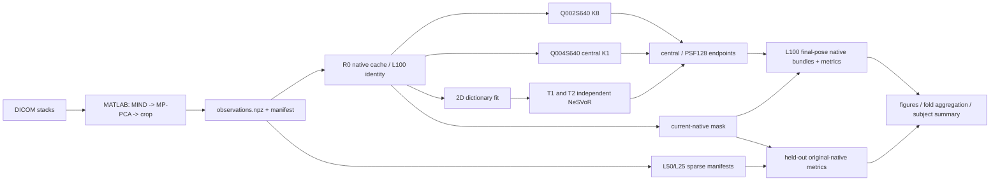

# Current formal pipeline audit

Audit date: 2026-10-21. Code evidence is pinned to `dad9698b5b2b5cd98267a6d23f1eb866b54791d3`; the local worktree had unrelated untracked files and was not reset or cleaned. `LOCAL` means this CPU-only Codex host. Server outputs were not executed or mutated during this audit.

## Formal route inventory

| step_id | step_name and purpose | location / environment | entrypoint and evidence | inputs -> outputs / contract | status and overwrite policy |
|---|---|---|---|---|---|
| 01 | Discover DICOM stacks and subject-stack manifest | LOCAL CPU | `configs/subject_stack_manifest.json`; `trad/scripts/local_preprocess_all.m` | DICOM root -> declared sax/2ch/4ch paths; subject identity is explicit | Recomputable; manifest is provenance; no overwrite of historical manifest |
| 02 | MATLAB preprocessing: validate protocol and ingest 10 weights/group | LOCAL MATLAB | `trad/scripts/local_preprocess_one.m`, `preprocess_stack_v1.m` | DICOM -> registered/denoised stack; frozen route requires 10 weights | CPU-only / moderate; output path must be new |
| 03 | MIND registration HB2..HB10 to HB1 | LOCAL MATLAB | `preprocess_stack_v1.m` | multi-weight group -> HB1-aligned group | Formal preprocessing dependency; recomputable from source DICOM |
| 04 | MP-PCA denoising | LOCAL MATLAB | `mppca_denoise_multimap_stack.m` | registered 7x7x10 neighborhoods -> denoised magnitudes | Formal preprocessing dependency; recomputable |
| 05 | Central crop and geometry-origin update | LOCAL MATLAB | `preprocess_stack_v1.m`; `build_manifest.py` crop affine code | full image -> `Mag_crop` plus crop origin; no implicit coordinate conversion | Formal geometry contract; recomputable |
| 06 | Persist `preprocessed.mat` | LOCAL MATLAB | `local_preprocess_all.m:44-49` | preprocessing outputs -> `<root>/<subject>/<stack>/preprocessed.mat` | Formal bridge input; refuse to replace an approved artifact |
| 07 | Build observations | LOCAL CPU Python | `trad.modules.module_02_data_bridge.prepare_observations` | `preprocessed.mat` + DICOM -> `observations.npz`, `timing.npy`, `manifest.json`, `qc_summary.json`; consumes `mag_crop` | Bridge asserts 10 observations/group; recomputable |
| 08 | Validate observations / provenance | LOCAL CPU | `build_manifest.py`, `prepare_observations.py:48-106` | DICOM UIDs, cropped affine, TR/VPS -> manifests and QC | Must preserve geometry and UID evidence |
| 09 | R0 full/L100 identity | SERVER_GPU for reconstruction; server CPU for metadata | `phase2_clean/sparse.py:103-166` | full prepared observations -> `L100_fold0/sparse_manifest.json`; L100 reuses R0, is not retrained | Immutable formal output |
| 10 | Create L50/L25 folds | SERVER_CPU or LOCAL CPU | `phase2_clean/sparse.py` | LAX groups -> regular stride/phase derived sets; SAX retained | Schema is `condition`, `phase`; formal case is `f"{condition}_fold{phase}"` |
| 11 | Resolve approved simulator and B6 | SERVER_GPU | `run_q002_reconstruction.py:98-107`; server wrappers | frozen decoder + B6 -> provenance hashes in run manifests | Frozen external dependencies; never retrain per subject |
| 12 | Q002S640 proposed reconstruction | SERVER_GPU | `run_q002_reconstruction.py`; formal entry uses experiment ID `Q002S640_B6_roi_same_anchor_mse` | prepared inputs + frozen dependencies -> checkpoint, native reprojections, endpoints | Training K8; immutable output |
| 13 | Q004S640 proposed reconstruction | SERVER_GPU | `run_q004_s640_k1_reconstruction.py`; `phase2_clean/q004s640.py`; `server_commands/run_q004s640_cyj.sh` | same route -> Q004 K1 outputs | Frozen: batch 640, MSE-only, cosine off, 2000+4000, seed 20260911, central K1 |
| 14 | Fit-first native dictionary matching | SERVER_CPU | `phase2_clean/fit_first.py`, `dictionary.py:20-24` | observations -> native T1/T2 maps; normalized cosine, no interpolation/refinement | Requires TR=2.61/VPS=87; immutable cache |
| 15 | Independent T1/T2 NeSVoR | SERVER_GPU | `fit_first.py:251`; NeSVoR executable | parameter-specific native maps -> independent volumes/models/results | T1 and T2 final poses must not be shared |
| 16 | R0 native cache | SERVER_CPU | `native_reference.py`, `fit_first.py`, `final_cyj_reporting.py` loader | full native maps -> verified source/reference/cache groups | Formal retained artifact; do not archive |
| 17 | Audit Fit-first final slice poses | SERVER_CPU | `fit_first_native_pose_audit.py`; `fit_first_native_bundles.py:41-44` | NeSVoR result/model -> final output slice correspondence | Fail closed on geometry mismatch |
| 18 | Current-native primary mask | SERVER_CPU | `current_native_central_component_mask.py` | R0 source support AND frozen L100 support -> central/largest 8-connected component mask | No interpolation/resampling; immutable |
| 19 | Export central/PSF128 endpoints | SERVER_GPU | `run_q002_reconstruction.py:86-97`; `export_quantitative_outputs_psf128` | learned model -> endpoint exports and manifests | Endpoint identity is explicit, not inferred from directory |
| 20 | Direct L100 native bundle | SERVER_CPU | `direct_native_bundles.py` | direct endpoint + final learned pose -> original native samples | L100 only uses learned final pose |
| 21 | Fit-first L100 final-pose native bundle | SERVER_CPU | `fit_first_native_bundles.py:73` | endpoint + audited parameter-specific final poses -> native bundles | T1/T2 independent final-pose policy |
| 22 | L100 paired native metrics | SERVER_CPU | `final_pose_native_metrics.py` | two L100 bundles + current mask -> paired metrics | Common support; immutable output |
| 23 | L50/L25 held-out native metrics | SERVER_CPU | `final_sparse_native_metrics.py:77-115` | sparse manifest held-out IDs + R0 cache + endpoints -> metrics | Original held-out native geometry; `no_learned_pose=True` |
| 24 | Native qualitative mosaics | SERVER_CPU | `final_cyj_reporting.py`; `visualize_heldout_native_planes.sh` | native bundles/metrics -> mosaics | Read-only reporting; shared parameter LUTs |
| 25 | SCMR-style longitudinal figures | SERVER_CPU | `scmr_compatibility_eval.py`, `final_cyj_reporting.py` | formal endpoints/masks -> longitudinal figures | Historical geometry transplant remains archived/rule reference, not primary formal path |
| 26 | Fold aggregation | SERVER_CPU | `final_cyj_reporting.py:_summaries` | per-fold metrics -> L50/L25 mean and sample SD | Fold is a within-subject replicate, not a subject |
| 27 | Subject final summary | SERVER_CPU | `final_cyj_reporting.py:aggregate_final_cyj` | reports -> summary CSV/JSON/Markdown | Immutable output; current implementation name is legacy CYJ terminology |
| 28 | Future multi-subject aggregation | SERVER_CPU | design in `docs/MULTI_SUBJECT_STATISTICS_PLAN.md` | subject summaries -> across-subject statistics | Design only; no data fabricated |

## Frozen dependencies

| dependency | server path | identity / subject scope | required provenance |
|---|---|---|---|
| approved signal simulator | `/data/dengyz/dataset/Code_10w_v1/Code_10w_runs/CYJ_decoder_comparison_20260924_clean_v1/inputs/mlp/signal_simulator_approved.pth` | subject-independent frozen dependency; the `CYJ` path component is storage history, not evidence that it is CYJ-only | declared SHA256 `f83280d4f73bfc9e0540b9606ee20bf83395339ad4e54dd0fb7be93ed9c9a7a9`, source path, copied/resolved path |
| frozen B6 | `/data/dengyz/dataset/Code_10w_v1/Code_10w_runs/CYJ_decoder_comparison_20260924_clean_v1/runs/frozen_mlp_B6/model.pt` | subject-independent frozen dependency consumed by the Q002/Q004 route | path, SHA256 measured on server, B6 configuration provenance |

The local host cannot read the server paths, so the simulator SHA above is declared rather than independently re-hashed here. Both dependencies are `KEEP_FORMAL`; DYL_2 must reuse them only after protocol admission, never retrain them.

## Audited implementation debt

`q004s640.py` and the current-native mask previously encoded CYJ subject identity and CYJ group counts. These are implementation restrictions, not scientific restrictions: sparse manifests already carry subject, condition and group identities. The adapter now takes `--subject` (default `CYJ`) and the mask derives its expected plane count from verified cache group IDs. Q002/Q004 training fields, case list (no L33), final-pose rule, held-out rule, endpoint checking, and immutable-output checks are unchanged.
